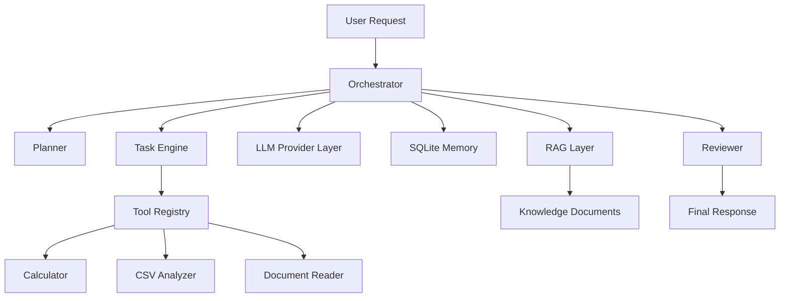
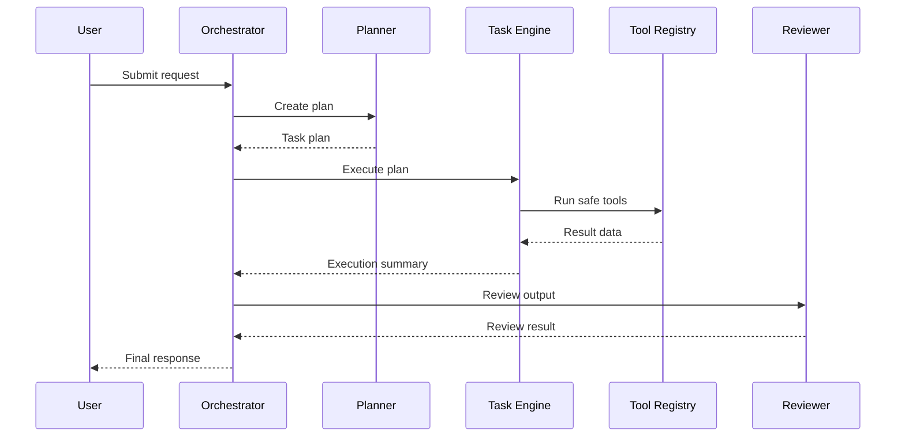

# Multi-Agent AI Task Assistant

A local, safe, and portfolio-friendly multi-agent assistant for planning, executing, and reviewing task workflows using local tools. The default runtime is Demo Mode, which works without an external API key, while the architecture is designed so a real LLM provider can be added later without rewriting the rest of the system.

## Why this project exists

This project demonstrates a practical multi-agent workflow that can:

- receive a natural-language request,
- create a structured plan,
- execute safe local tools,
- store task and session state in SQLite,
- review outputs for missing evidence or obvious mistakes,
- expose the same logic through both Streamlit and FastAPI.

## Core architecture

The project separates responsibilities into clear modules:

- Orchestrator: manages request flow, task creation, and execution.
- Planner: converts a request into a structured step plan.
- Task Engine: executes steps while respecting dependencies and limits.
- Agents: research, data analysis, coding, and review roles.
- Tool Registry: keeps all tool calls validated and registered.
- Memory Layer: stores sessions, messages, tasks, and knowledge metadata in SQLite.
- RAG Module: supports local document loading, chunking, and retrieval.
- LLM Provider Layer: supports Demo Mode and future provider extension.

## Agent roles

- Research Agent: identifies the task context and source material.
- Data Analyst Agent: verifies CSV and structured data inputs.
- Coding Agent: prepares implementation strategy and safe task execution.
- Reviewer Agent: checks whether the result is complete and evidence-based.
- Orchestrator Agent: coordinates execution flow and final response.

## Tools available

- calculator: safe arithmetic evaluator, no eval/exec
- text_search: search text for relevant spans
- document_reader: reads supported local text files with path safety
- csv_analyzer: summarizes CSV rows, columns, and missing values
- report_writer: writes Markdown reports into the outputs folder
- datetime_tool: returns the current system time
- task_manager: creates simple task records
- knowledge_retriever: retrieves relevant local chunks

## Demo Mode behavior

When no real LLM API key is configured, the system operates in Demo Mode. Demo Mode is intentionally limited and clearly labeled. It can:

- classify general task types,
- produce a basic plan from known templates,
- run local safe tools,
- record task state,
- return a clearly marked demo answer.

It does not claim to be a full-featured reasoning model.

## RAG flow

The local RAG layer is intentionally lightweight:

- load supported text documents,
- split them into chunks with overlap,
- store chunk metadata in SQLite,
- retrieve the most relevant chunks using local token similarity,
- keep the retrieved text separate from system instructions.

## Technologies used

- Python 3.11+
- FastAPI
- Streamlit
- Pydantic
- SQLite
- Pandas and NumPy
- pytest

## Mermaid diagram: architecture



## Mermaid diagram: execution flow



## Project structure

```text
Multi-Agent AI Task Assistant/
├── app.py
├── README.md
├── requirements.txt
├── pyproject.toml
├── .env.example
├── .gitignore
├── LICENSE
├── config/
│   └── settings.py
├── src/
│   ├── api/
│   ├── agents/
│   ├── core/
│   ├── llm/
│   ├── memory/
│   ├── rag/
│   ├── tools/
│   ├── ui/
│   └── __init__.py
├── tests/
├── data/
├── storage/
├── outputs/
├── docs/
└── .venv/
```

## Operating requirements

- Python 3.11 or newer
- Local Windows environment or any compatible Python environment
- Network access only for package installation
- No paid API key required for default demo operation

## Windows installation steps

1. Open a terminal in the project folder.
2. Create a virtual environment:

```powershell
py -m venv .venv
```

3. Activate it:

```powershell
.\.venv\Scripts\Activate.ps1
```

4. Install dependencies:

```powershell
python -m pip install -r requirements.txt
```

5. Create a local environment file if needed:

```powershell
Copy-Item .env.example .env
```

## Run the Streamlit app

```powershell
python app.py
```

or directly:

```powershell
streamlit run app.py
```

## Run the FastAPI app

```powershell
uvicorn src.api.main:app --reload --host 127.0.0.1 --port 8000
```

## Run tests

```powershell
python -m pytest -q
```

## Example usage

- "Analyze a CSV sales file and summarize the missing values."
- "Create a brief implementation plan for a small Python utility."
- "Review this document and give me a concise summary with limits."

## Demo mode limits

- It does not pretend to be a production-grade model.
- It does not access the internet or external services by default.
- It is designed for safe local demonstrations and project portfolio use.

## Adding a real LLM provider

The provider layer is intentionally isolated in the [src/llm](src/llm) package. To add a real provider, implement the same interface as the Demo provider and update the factory logic in [src/llm/provider_factory.py](src/llm/provider_factory.py).

## Security notes

This project intentionally avoids unsafe execution patterns such as `eval`, `exec`, or shell command interpolation. It validates file paths, content types, and tool inputs before use. It is suitable for local development and safe demo workflows, but it is not a fully hardened public deployment.

## Troubleshooting

- If imports fail, confirm you are using the project venv.
- If SQLite tables are missing, run the app or import the database module to initialize them.
- If a file upload is refused, verify the extension and size limit.
- If tests fail, rerun `python -m pytest -q` to inspect the exact failure.

## Roadmap

- add a real cloud LLM provider behind a flag,
- implement stronger document indexing and retrieval,
- add richer task state transitions,
- improve the Streamlit dashboard with more task metadata,
- add deployment configuration for a small self-hosted setup.

## License

This project is licensed under the MIT License.

## Important note

This is a local educational and portfolio-oriented project. It is not a fully autonomous production system with unrestricted security guarantees.
